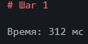
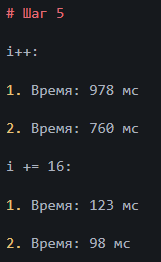
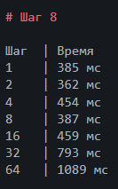

# Шаг 1

Время: 312 мс

# Шаг 5

i++:

1. Время: 978 мс

2. Время: 760 мс

i += 16:

1. Время: 123 мс

2. Время: 98 мс

# Шаг 8

Шаг  | Время
1    | 385 мс
2    | 362 мс
4    | 454 мс
8    | 387 мс
16   | 459 мс
32   | 793 мс
64   | 1089 мс

# Итоговый вопрос

Потому что выходнее все сразу загрузить, нежели каждый раз брать по 1 элементу.
Кэш хранит часто используемые данные ближе к процессору. 
Если программа обращается к данным рядом друг с другом, процессору легче
использовать уже загруженную в кэш информацию.

# Контрольный вопросы

1. Затем, что кеш хранит часто используемые данные.
2. Процессор работает значительно быстрее оперативной памяти.
3. Кэш-линия - это соединяющее между процессором и кэш-памятью.
4. Потому что программа обращается к данным рядом друг с другом, процессору легче
использовать уже загруженную в кэш информацию.
5. Потому что при повтором использовании программы некоторые данные сохраняются в кэш-памяти и в итоге могут повторно использоваться.

# Итоговый вывод

Наш эксперимент показал вот такие результаты и такие изменения времени:

Кэш-память играет роль хранителя недавно использующих данных программы.
